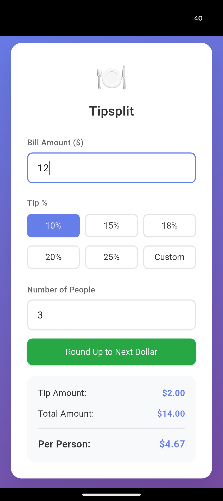

# Tipsplit

**Calculate tips and split bills effortlessly**

<p align="center">
  
</p>

Tipsplit is the ultimate tip calculator that makes dining out stress-free. Whether you're at a restaurant, bar, or café, calculate the perfect tip and split the bill among friends in seconds.

## Key Features

- **Instant Calculations** – Results update automatically as you type
- **Smart Tip Options** – Quick buttons for 10%, 15%, 18%, 20%, 25% or set your own custom percentage
- **Bill Splitting** – Easily divide the total among any number of people
- **Round Up Feature** – One-tap rounding to the nearest dollar for convenience
- **Clean Interface** – Large, easy-to-read numbers and intuitive design
- **Works Offline** – No internet connection required
- **Lightning Fast** – No loading times or "calculate" buttons needed

## How it works

1. Enter your bill amount
2. Select or customize your tip percentage
3. Add number of people (if splitting)
4. See instant results for tip amount, total, and cost per person

## Building

This is a Flutter app targeting Android.

```sh
flutter pub get
flutter test
flutter build apk --release
```

The release APK at `build/app/outputs/flutter-apk/app-release.apk` is left
unsigned on purpose: F-Droid signs the APK with its own key. It will therefore
fail to install when sideloaded directly.

For local testing, build a debug APK instead. It is signed with the Android
debug key and can be installed directly:

```sh
flutter build apk --debug
# -> build/app/outputs/flutter-apk/app-debug.apk
```

## Localization

The app uses Flutter's built-in `gen-l10n` workflow. English strings live in
`lib/l10n/app_en.arb`; each additional language is a single `app_xx.arb` file
plus `flutter gen-l10n`. Localization is generated automatically on build.

## License

Copyright (C) Tipsplit contributors.

This program is free software: you can redistribute it and/or modify it under
the terms of the GNU General Public License as published by the Free Software
Foundation, either version 3 of the License, or (at your option) any later
version. See [LICENSE](LICENSE).
